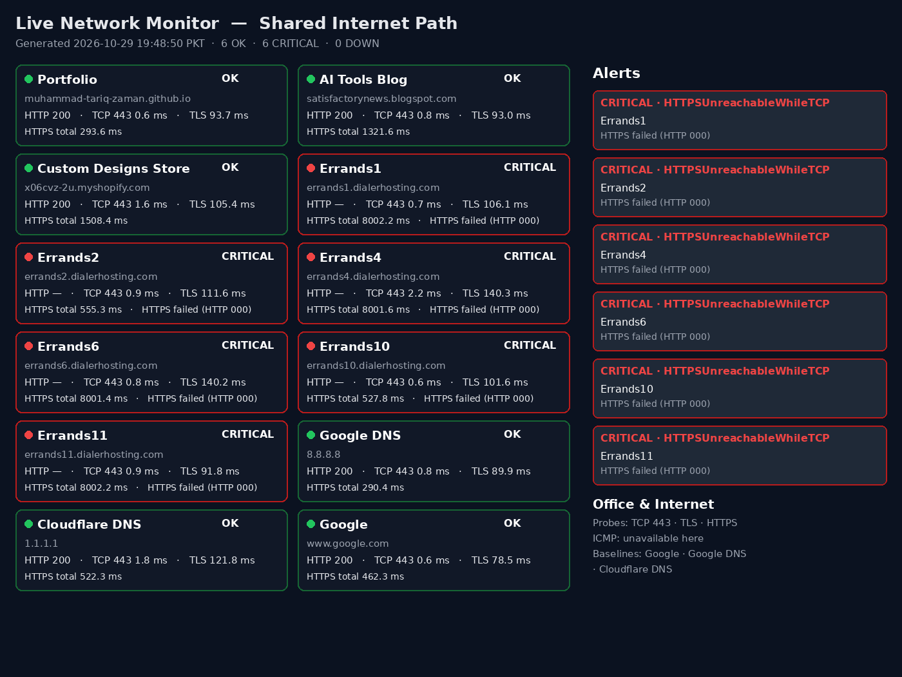

# Live Network Monitoring Dashboard

A small, working network monitor in the style of a shared-internet-path
dashboard: one vantage point, probed sites with TCP 443 / TLS / HTTPS
latency, and a CRITICAL alerts panel. Python standard library + curl.
No database, no Docker, no account, no cost.



## Quick start

```bash
python3 dashboard.py --port 8000 --interval 60
# open http://localhost:8000
```

Or a one-off probe:

```bash
python3 probe.py --out status.json
```

## What it does

- Probes each target in order: DNS → TCP 443 → TLS handshake → HTTPS GET.
- Statuses: **OK** (HTTPS 200–399), **CRITICAL** (TCP answers but HTTPS
  fails — `HTTPSUnreachableWhileTCP`), **DOWN** (DNS/TCP failed).
- Public baselines (Google, Google DNS, Cloudflare DNS) sit next to
  your own sites, so you can tell a site outage apart from an internet
  outage.
- The page refreshes from `/api/status` every 30 seconds; every probe
  run also writes `status.json`.

## Real test (29 Oct 2026, 12 targets)

6 OK, 6 CRITICAL, 0 DOWN. The author's Portfolio, AI Tools Blog and
Custom Designs Store were up (HTTP 200), all public baselines were up,
and all six WFS nodes at Hakeem Walee
failed HTTPS while TCP answered — the same pattern the photo's alerts
panel shows. Full table and cautions in [MANUAL.md](MANUAL.md) §5.

## Files

- `probe.py` — prober and status rules
- `dashboard.py` — live server (`/`, `/api/status`)
- `MANUAL.md` — the full manual: process, setup, troubleshooting,
  applications and advantages, limits
- `screenshots/` — dashboard images rendered from live probe data

## Note on ICMP and latency

ICMP ping is unavailable on hosts that block raw sockets (this sandbox
does), so it is reported as unavailable, never as a failure. TCP times
measured through an egress proxy are proxy times, not office-to-server
times — run it inside the office for the office's real numbers.
See MANUAL.md §3, §5 and §10.
